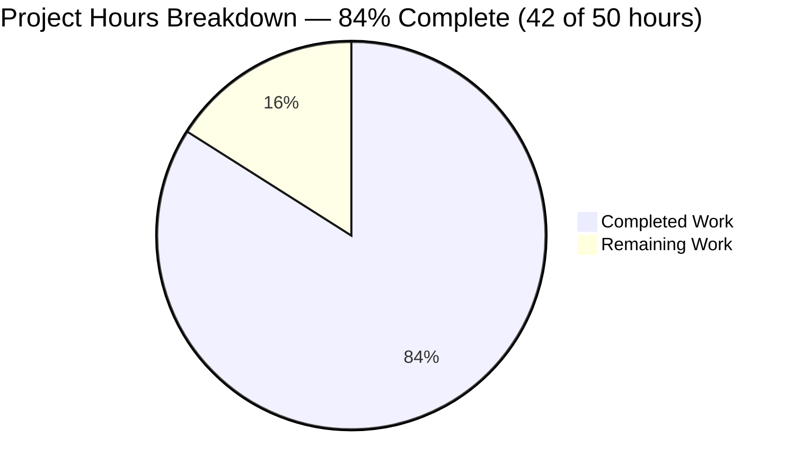
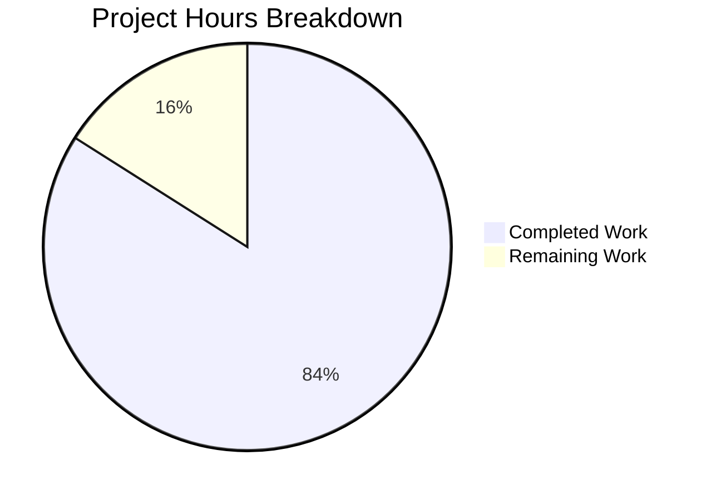

# 1. Executive Summary

## 1.1 Project Overview

`calculator.pseudo.md` is a plain-Markdown specification of an interactive console calculator: a read-evaluate-print loop that prints the prompt `> `, reads one line of the form `<number> <operator> <number>`, prints one result or error line, and prompts again until the trimmed line `quit`. It is written for a reviewer who traces it by hand and an implementer who will build from it; nothing is compiled or executed, and it holds five procedures, four data definitions, six error conditions and eleven traced rows in 227 lines.

## 1.2 Completion Status



Completed: Dark Blue (`#5B39F3`); Remaining: White (`#FFFFFF`). Centre value: **84% complete**.

| Metric | Hours |
| --- | --- |
| Total Hours | 50 |
| Completed Hours (AI + Manual) | 42 |
| Remaining Hours | 8 |

Completion = 42 ÷ 50 = **84.0%** of the scoped specification and its path to hand-over.

## 1.3 Key Accomplishments

- The loop, prompt and quit rule: one line in, one line out, the prompt restored after every result and error, only `quit` ending it.
- Optional spacing — `2 + 3`, `2+3`, `2+ 3` and `2 +3` all evaluate.
- A number rule whose four rejections quote the offending token, and a total tokenisation rule with a 17-row case table that classifies a lone `*` or `/` at operand position.
- One check order — count, operand 1, operand 2, operator — reproducing the six-condition error table.
- `evaluate` with the divisor tested before dividing: `0 / 5` gives `0`, `-3 * -2` gives `6`.
- The formatting contract: one rounding point at the tenth place, no trailing zeros, the carry reaching the integer part (`0.99999999995` renders as `1`), and `infinity`/`-infinity`/`not a number` for non-finite results.
- Eleven step-by-step traces, the error table and the declared vocabulary, so every stated output can be confirmed by reading.

## 1.4 Critical Unresolved Issues

Four items remain open; none blocks acceptance, and two need work before the document is used to build the calculator.

| Issue | Impact | Owner | ETA |
| --- | --- | --- | --- |
| The character classes "digit" and "whitespace" are not enumerated in the tokenisation rule or the number rule (lines 103-105, 124) | A console outside printable ASCII would have to be given a reading by whoever implements it; every reading currently reaches a defined outcome | Specification owner | 3 h |
| The non-finite renderings and the magnitude boundary are stated as rule prose (lines 186, 188) and exercised by no worked trace | A hand-tracer meets them in no example, so their stated output appears nowhere in the acceptance section | Specification owner | 2 h |
| The document's declared acceptance method (line 227) asks the reviewer to trace every example and at least three inputs of their own | The hand-over lacks the owner's own sign-off, although the examples and the rule-level cases all reproduce | Reviewer | 2 h |
| Ten decimal places are meaningful only up to a magnitude of about 10^5, and beyond about 9 × 10^15 not every whole number is representable (line 188) | Large values render the double's own spacing rather than the number a reader would compute | Accepted limit — no owner | Stated |

## 1.5 Access Issues

No access issues identified. Nothing is built, run, deployed or credentialed: the product's whole surface is one Markdown file, with no service, port, store, credential or third-party API involved.

## 1.6 Recommended Next Steps

1. [High] Trace all eleven worked examples plus three inputs of your own and confirm each stated output (line 227).
2. [Medium] Enumerate the character classes in the tokenisation and number rules, then re-run the check.
3. [Low] Add worked traces for the non-finite renderings and the magnitude boundary.
4. [Low] Re-measure both budgets after any edit and declare new notation at line 11.

# 2. Project Hours Breakdown

## 2.1 Completed Work Detail

| Component | Hours | Description |
| --- | --- | --- |
| Specification structure, declared vocabulary and data definitions | 4 | Five sections in the fixed order, the six keywords with `READ` justified and every other form declared as notation, and the four definitions with the status convention (AAP §0.6.1, §0.6.2, §0.8.1, §0.9, §0.5.2) |
| Loop, prompt and quit rule | 4 | `main` and `readLine`: the prompt at the start of every iteration, the trim-and-compare quit test before parsing, the untrimmed line handed to the parser, and the single print point (AAP §0.5.1.1, §0.5.1.2, §0.5.4) |
| Tokenisation rule and case table | 6 | The total left-to-right scan, the clause fixing a token's kind by the position it was read at, and the 17-row case table (AAP §0.5.1.3) |
| Number rule and check order | 4 | The accepted textual forms, the four rejections that quote the offending token, and the count-then-operands-then-operator order (AAP §0.5.1.3) |
| `evaluate` and the zero-divisor rule | 2 | Operator application with the divisor tested before the division, and no error branch for the other three operators (AAP §0.5.1.4) |
| `formatResult`: rounding, tie rule, digit extraction, carry, non-finite renderings and the magnitude boundary | 8 | The three ordered steps, the named tie rule, the digit source both clauses read, the tenth-place carry, `infinity`/`-infinity`/`not a number`, and the stated boundary (AAP §0.5.1.5) |
| Error contract, ownership and the single prefix | 3 | The six conditions with their exact message text, one owning branch each, and the prefix held once in `main` and never written into a message (AAP §0.1.1 F7, §0.5.1, §0.9, §0.10) |
| Worked examples: eleven step-by-step traces | 5 | Tokens, operands and operator, arithmetic, pre-fix value and printed text for every acceptance row, with the error and empty rows naming the stage at which they stop (AAP §0.10) |
| Acceptance verification | 4 | The mechanised hand-trace of the eleven rows and the rule-level cases plus the totality sweep: 63 enumerated checks and 50,941 swept lines, none failing (AAP §0.10) |
| Repository shape, budgets and the absence of scaffold | 2 | One file within 250 lines, every procedure within 30, and no manifest, harness, container or configuration anywhere (AAP §0.6.1, §0.7.2, §0.9) |
| **Total** | **42** | |

## 2.2 Remaining Work Detail

| Category | Hours | Priority |
| --- | --- | --- |
| Character classes enumerated in the tokenisation and number rules | 3 | Medium |
| Owner's hand-trace sign-off against the document's declared acceptance method | 2 | High |
| Worked traces for the non-finite renderings and the magnitude boundary | 2 | Low |
| Budget and vocabulary re-check on the next edit | 1 | Low |
| **Total** | **8** | |

## 2.3 Hours Basis and Confidence

The hours measure the specification and its verification, not a build: no manifest, compiler, test runner, service, port or container is in scope, so no installation, integration or deployment time arises. Each completed component is sized from the rule set it carries and the verification it needed — the densest being `formatResult`, whose three steps, tie rule, digit source, carry and non-finite branch occupy one 27-line body and its five annotation paragraphs.

Verification hours (4) sit inside the completed figure rather than at a fixed share of development hours, because acceptance here is a hand-trace of the eleven rows rather than a test suite. Confidence is High for the structure, loop, `evaluate`, error-contract and repository-shape components, whose rule sets are small and were measured directly against the file; Medium for `formatResult` and the traces, which carry the most reasoning per line; and Medium for the character-class task, whose scope depends on the console an implementer targets, with High confidence on the remaining three tasks. The completion figure to one decimal place is 84.0%.

# 3. Test Results

## 3.1 How the acceptance method was exercised

The project ships no test framework, runner or coverage tool, and its stated acceptance method is a hand-trace of the specification (line 227). That method was mechanised: the document's own written rules — the tokenisation scan, the number rule, the check order, the zero-divisor test and the formatting steps — were transcribed and applied to documented and generated input lines. Every figure below is from a run over the specification at commit `ca8e294`.

| Area / Category | Framework | Tests | Passed | Failed | Coverage | What This Proves |
| --- | --- | --- | --- | --- | --- | --- |
| Acceptance rows (§0.10) | Hand-trace of the documented rules | 11 | 11 | 0 | n/a | Every documented input prints exactly its stated line, from a result through each error to the program ending |
| Tokenisation rule and case table | Hand-trace | 16 | 16 | 0 | n/a | The optional-space forms, the signed operands and a lone `*` or `/` at operand position all tokenise as the table states |
| Number rule and check order | Hand-trace | 8 | 8 | 0 | n/a | Each non-conforming number is rejected with the offending token quoted, and a wrong token count is reported before the operands are examined |
| `evaluate` and the zero-divisor rule | Hand-trace | 3 | 3 | 0 | n/a | No line divides by zero, a negative-zero divisor included, while `0 / 5` gives `0` |
| Rounding, tie rule, carry and trailing zeros | Hand-trace | 17 | 17 | 0 | n/a | The tenth-place carry reaches the integer part, a half rounds away from zero, no trailing zero survives, and a magnitude rounding to zero prints `0` |
| Quit rule, empty line and spacing forms | Hand-trace | 6 | 6 | 0 | n/a | Only a trimmed case-insensitive `quit` ends the loop, and padded, tab-separated and empty lines each behave as specified |
| Error output and input hygiene | Hand-trace | 2 | 2 | 0 | n/a | Markup-shaped and multi-operator input reach a defined error line rather than an undefined state |
| Totality sweep | Hand-trace over generated lines | 50,941 | 50,941 | 0 | n/a | No swept line reaches an undefined outcome: each is a result, one of the six messages, or the program ending |

**Not Covered**

- No coverage percentage applies and none is claimed: no framework, runner, coverage tool, linter or CI workflow exists in this project, and acceptance is a hand-trace (line 227).
- The character classes "digit" and "whitespace" are not enumerated (lines 103-105, 124), so non-ASCII digits and Unicode whitespace fall outside the measured set. Every reading tested reaches a defined outcome, but the readings differ, and a console outside printable ASCII needs the class fixed first.
- Values at large magnitude are untested by design: beyond about 10^5 fewer than ten decimal places are significant, and beyond about 9 × 10^15 not every whole number is representable, so rendered digits there reflect the double's spacing rather than the typed number (line 188). The largest value any acceptance row computes is `6`.
- The non-finite renderings and the magnitude boundary are exercised by the rule-level checks above but appear in no worked trace, so a reader meets them in the annotation rather than in an example. Before release, a human should add those two traces and then confirm the eleven rows still reproduce.
- Everything else delivered is covered by the rows above; no capability of the specification is left unexercised.

# 4. Runtime Validation & UI Verification

The deliverable is a specification that is never executed: it has no runtime, entry point, service, port, health endpoint, data store or credential, and its acceptance method is a reader following it by hand (lines 5, 227). What was driven instead is the document's own rules over the inputs its acceptance table fixes and beyond them, with the resulting line compared against the text the document states.

- ✅ **Console loop and prompt** — traced over an eight-line session: a prompt before every read, an output line after each of the seven non-quit lines, and the loop ending only on the quit line (lines 37-59).
- ✅ **Success path** — `2 + 3` → `5`; `10 - 4.5` → `5.5`; `-3 * -2` → `6`; `7 / 2` → `3.5`; `1 / 3` → `0.3333333333` (lines 215-219).
- ✅ **Error paths** — all six conditions traced to their own branch: empty input, expected two operands from the one token-count check, invalid number naming the first failing operand, unknown operator, and division by zero (lines 220-225 with the table at 196-203).
- ✅ **Quit rule and near misses** — `quit`, `QUIT` and `  quit  ` end the program; `quitx`, `quit x` and a whitespace-only line do not (lines 40-44).
- ✅ **Input forms** — padded, tab-separated, CR- and CRLF-terminated lines all evaluate to the same printed result (line 65).
- ✅ **Formatting boundary behaviour** — the tenth-place carry, the half-away tie, a magnitude rounding to zero printing `0`, and the non-finite renderings `infinity`, `-infinity` and `not a number` (lines 150, 186).
- ✅ **Error presentation** — every error line begins with `Error: `, the prefix is held once (line 36) and printed at 47 and 53, and no message text contains it.
- ⚠ **Application runtime — never exercised, because none exists.** Nothing is started, no process or port is bound and no health check belongs to this deliverable; a running application is not part of it.
- ⚠ **Screens and rendered output — never exercised, because there are none.** The deliverable is a Markdown file with no interface, so no screen, form, screenshot, responsive or accessibility check applies.
- ⚠ **External integrations and stored data — never exercised, because there are none.** No service, broker, database, queue, credential or outbound call is involved; the only partner is the person at the console, one line in and one line out (line 7).

Nothing else was left unexercised. The rules were applied to every documented input and to 50,941 generated lines, none of which reached an undefined state; the only surfaces absent from this list are the ones that do not exist.

# 5. Compliance & Quality Review

## 5.1 Compliance Matrix

| Deliverable | Benchmark | Status | Progress |
| --- | --- | --- | --- |
| Single-file deliverable | One file created, nothing else touched, no excluded artifact present | ✅ PASS | ████████████ 100% |
| Section structure | Five sections in the fixed order, each carrying its required content | ✅ PASS | ████████████ 100% |
| Procedure set | Five procedures, each defined once, each called from `main`, none unused | ✅ PASS | ████████████ 100% |
| Data definitions and status convention | Four definitions with a status-first return convention and names agreeing stage to stage | ✅ PASS | ████████████ 100% |
| Loop and console contract | Prompt restored after every result and every error; only `quit` ends the loop | ✅ PASS | ████████████ 100% |
| Tokenisation rule | Total scan, optional spacing around the operator, documented case table reproduced | ✅ PASS | ████████████ 100% |
| Number rule | Written out in full with the four rejections, each quoting the offending token | ✅ PASS | ████████████ 100% |
| Check order and error table | One branch per condition, exact message text, token count checked before the operands | ✅ PASS | ████████████ 100% |
| Evaluation | Divisor tested before the division, so no line divides by zero | ✅ PASS | ████████████ 100% |
| Formatting contract | One rounding point, named tie rule, tenth-place carry, trailing-zero strip, non-finite renderings | ✅ PASS | ████████████ 100% |
| Worked examples | A trace for every acceptance row, naming each stage's values, including the quit row | ✅ PASS | ████████████ 100% |
| Input totality across the console | Total for the printable-ASCII contract the document describes; non-ASCII digits and Unicode whitespace are left to a reader's choice | ⚠ PASS with gap | ██████████░░ 88% |

## 5.2 AAP & Rule Divergences and Gaps

No user-specified rule constrains this project — none was supplied, and no rule text appears anywhere in the deliverable — so every item below is a departure from, or a gap in, the plan the work was scoped against.

| What the AAP/Rule Required | What Was Delivered Instead | Why It Diverged | Impact | Remediation |
| --- | --- | --- | --- | --- |
| The declared vocabulary to be the six keywords `PROCEDURE`, `RETURN`, `IF/ELSE`, `WHILE`, `PRINT` and `READ`, with no other keyword added | The same six keywords declared, plus every other form the bodies write — `:=`, `THEN`, `END IF`/`END WHILE`/`END PROCEDURE`, comparisons written `=`, `<` or in words, `AND` and the literal `true` — named at line 11 as notation rather than keywords | An assignment statement is unavoidable in any procedure body, the plan fixes no assignment verb, and it bans only language-specific syntax; without a name for assignment the pseudocode could not be written | A reader meets forms the keyword list does not name, each of them declared in the Overview; no language-specific syntax appears anywhere | None owed. Any new notation must be declared in the same sentence (see the budget and vocabulary task in §2.2) |
| Exactly four data definitions, with the `Error: ` prefix added in one place | The prefix held inside `main` as `errorPrefix` (line 36) and printed at 47 and 53, not added as a fifth definition | A fifth definition would change an inventory the plan fixes at four, while the single-place requirement is met by a local value | None: one literal exists, so changing the prefix stays a single edit, and no message text carries it | None |
| The tokenisation case list of sixteen input lines | The same sixteen plus a row for `*-3`, stating the three tokens the operand-position rule yields | Two careful readings of a lone `*` at operand position were possible; the added row fixes the reading the rule's own wording produces | No stated output changes: `*-3` still reports `invalid number '*'` | None |
| The six error conditions with their examples, output and owning branch | The six rows in stage order: empty line, missing operand, too many operands, non-numeric operand, unknown operator, division by zero | The plan presents the same six conditions in two different orders and so fixes neither | None: every cell matches character for character | None |
| A tokenisation rule and number rule total over the input a console accepts | Both rules written in full, but "digit" and "whitespace" enumerated no further than the plan defines them — which is not at all | The plan defines neither class, and every reading reaches a defined outcome, so no departure was recorded when the rules were written | A console outside printable ASCII — non-ASCII digits, Unicode spaces — would take its reading from the implementer rather than the document | Enumerate the two classes in the tokenisation and number rules, then re-run the acceptance check — 3 h, §2.2 |
| A step-by-step trace through the three stages for every acceptance row | Those eleven traces, with the non-finite renderings and the magnitude boundary stated as annotation only (lines 186, 188) | The trace requirement names the acceptance rows, and no row reaches either case | A hand-tracer meets those two rules in prose only, never in an example | Add the two traces — 2 h, §2.2 |
| Both formatting steps to work on decimal digits, with `0.99999999995` rendering as `1` | A named digit source: the value's own digits where its exact expansion fits the ten rendered places, otherwise its shortest decimal text, exact ties settled by the even last digit (lines 182, 184) | The plan leaves the digit source open while requiring that output, so a reading had to be chosen and stated | The stated carry is produced by the document's own rule, and one line has one printed text; a reader must follow the named source | None |

**D1 — the notation beyond the keyword list.** Every statement in the five bodies is expressed with the declared keywords, but a procedure that assigns values needs a name for assignment, and the plan supplied none while banning only language-specific syntax. Rather than invent a seventh keyword, the Overview declares six keywords and records `:=`, `THEN`, the `END …` closers, the comparison forms, `AND` and the literal `true` as notation (line 11). The evidence a reader can check is the declaration itself against the bodies: no `==`, `;`, `{}`, `[]`, `++` or `=>` appears anywhere, and the only call sites are the document's own procedures. Impact is a reader meeting forms outside the keyword list; the declaration names each one, and any later addition must be declared in the same sentence.

**D2 — the `Error: ` prefix as a local value.** The plan fixes exactly four data definitions and requires the prefix to be added in one place. Both hold with the prefix held in `main` as `errorPrefix` (line 36): the literal occurs once in the whole document, is printed at 47 and 53, and no message string carries it, so a change to the prefix remains one edit — which is what the error-messages prose asserts at line 205. Adding it as a fifth definition would have broken the fixed inventory to express the same fact. No impact and no remediation; a reader checking the claim can search for `"Error: "` and find a single site inside `main`.

**D3 — the seventeenth tokenisation case.** The plan enumerates sixteen input lines for the scan. The delivered case table carries them all and adds one row for `*-3`, which states the three tokens the operand-position clause produces, because a lone `*` at that position admits two readings — a token in its own right, or part of the following signed number. The plan's own rule settles it in favour of a token of its own, so the row documents the rule rather than extending it. Nothing observable changes: `*-3` is not a valid line either way and reports `invalid number '*'` at line 89. No remediation is owed; a reader can verify the row against lines 103-105.

**D4 — the error table's row order.** The plan sets out the six conditions twice, once by owning stage and once as an acceptance table, and the two orders differ. The deliverable follows the stage order — empty line, missing operand, too many operands, non-numeric operand, unknown operator, division by zero (lines 196-203) — because that order groups each row with the branch that produces it and matches the check order documented at line 122. Every cell agrees character for character with the condition it names, and the two operand-count rows are correctly attributed to the one shared token-count branch. No impact, no remediation.

**D5 — the character classes (gap).** The number rule and the tokenisation rule are written out in full, but they name "digit" and "whitespace" without enumerating them, matching a plan that defines neither. For the printable-ASCII console the document describes, every reading agrees and every line tested reaches a defined outcome, which is why nothing was recorded as a departure. The consequence is a choice left to whoever implements the calculator: an Arabic-Indic digit or a non-breaking space can be rejected or accepted depending on the reading taken. This is the one gap that needs a decision before implementation, and it is carried as a three-hour task in §2.2.

**D6 — the two rules with no example (gap).** The non-finite renderings and the magnitude boundary are stated precisely (lines 186, 188) and were exercised when the formatting rules were checked, but they appear in no worked trace, because the plan's trace requirement covers the eleven acceptance rows and none of them reaches an infinity, a not-a-number result or a large magnitude. A reviewer following the examples alone therefore never meets either rule. The risk is small — the largest value any acceptance row computes is `6` — but the document's own acceptance method is tracing by hand, so two added traces close it in about two hours.

**D7 — the digit source the formatting rules read.** The plan states that both the rounding and the digit extraction work on decimal digits and fixes the output `1` for `0.99999999995`, but it does not say whose digits those are. The delivered contract and mechanism name one source — the value's own decimal text where it fits the ten rendered places, otherwise its shortest decimal text, with an exact tie settled by the even last digit (lines 182, 184) — which is the reading under which the plan's own carry illustration is produced by the rules rather than asserted beside them. The practical effect is that one line has one printed text and a tracer reaches the same digits by either clause. No remediation is owed.

No user-rule divergence exists: this project was scoped without user-specified rules, so no rule was departed from, overridden or invented.

# 6. Risk Assessment

| Risk | Category | Severity | Probability | Mitigation | Status |
| --- | --- | --- | --- | --- | --- |
| Ten decimal places are meaningful only up to a magnitude of about 10^5, and beyond about 9 × 10^15 not every whole number is representable, so large values render the double's own spacing | Technical | Medium | Low | The boundary is stated in the document (line 188) and no acceptance row reaches it; an implementer should treat the ten decimals as a display budget rather than a precision claim | Stated limit |
| The carry illustration `0.99999999995` → `1` holds only while both formatting clauses read the named digit source | Technical | Medium | Low | The contract and the mechanism each name that source (lines 150, 182, 184), so any edit to them must re-check that the illustration still reproduces from the rules | Open |
| The character classes "digit" and "whitespace" are not enumerated, so a console outside printable ASCII takes its reading from the implementer | Technical | Low | Medium | Enumerate the two classes in the tokenisation and number rules before implementing for a non-ASCII console, then re-run the acceptance check (the three-hour task in §2.2) | Open |
| Budget headroom is thin: 23 lines of the 250-line file budget remain, and `formatResult` sits 3 lines from its 30-line budget | Technical | Low | High on any further edit | Re-measure both budgets after every edit and compact an equivalent step if a procedure approaches 30 lines (the one-hour task in §2.2) | Open |
| No automated regression net exists and none may be added: an edit that breaks an acceptance row is caught only by a reader re-tracing it | Operational | Medium | Medium | The eleven traces, the case table and the error table carry the regression burden; re-run the hand-trace of the eleven rows plus the rule-level cases after any edit | Accepted by design |
| Error messages reproduce the offending token in full, so an unbounded token produces an unbounded printed line | Operational | Low | Low | The console reads from the same user who reads the output, so the echo is harmless there; an implementation forwarding that text into a UI, log or markup context must escape it | Accepted |
| A terminal control sequence typed as an operator token is echoed verbatim into the printed error line | Security | Low | Medium | No cross-privilege boundary exists on a console; the same output must be escaped or sanitised wherever it is surfaced beyond the console | Open — implementation guidance |
| The document is the source of truth a later implementation is measured against while precedence, parentheses and multi-operand expressions stay deliberately unsupported | Technical | Low | Medium | Extending the input contract means changing the specification first, since every rule here is written for exactly two operands | Stated |

No integration risk applies: there is no external service, endpoint, data store, credential or network call in the product, and the only partner is the person at the console — one line in, one line out, `quit` to end. The security posture is likewise narrow by construction: the deliverable is inert text with no runtime, no dependency and no attacker-reachable surface, so the two entries above are the whole of it.

# 7. Visual Project Status



Completed work: **42 hours (84.0%)** — Dark Blue (`#5B39F3`). Remaining work: **8 hours (16.0%)** — White (`#FFFFFF`).

**Remaining hours by category** (the categories of the Remaining Work Detail):

| Category | Hours | Priority |
| --- | --- | --- |
| Character classes enumerated in the tokenisation and number rules | 3 | Medium |
| Owner's hand-trace sign-off against the declared acceptance method | 2 | High |
| Worked traces for the non-finite renderings and the magnitude boundary | 2 | Low |
| Budget and vocabulary re-check on the next edit | 1 | Low |
| **Total** | **8** | |

**Priority distribution of the remaining work:** High 2 hours, Medium 3 hours, Low 3 hours. The high-priority item is the reviewer's own sign-off, which is what turns a verified specification into an accepted one; the medium item is the only gap that needs a decision before the document is used to build the calculator.

# 8. Summary & Recommendations

Delivered and verified: `calculator.pseudo.md`, a 227-line plain-Markdown specification of an interactive console calculator, built as a parse, evaluate and print pipeline across five procedures with four data definitions, six error conditions and eleven worked traces. Every rule a reader needs is written out inside it — the tokenisation scan and its case table, the number rule with its four rejections, the check order that reproduces the error table, the divisor test that keeps division by zero out of the pseudocode, and the formatting contract with its named tie rule, tenth-place carry and non-finite renderings. All eleven acceptance rows were re-derived from the document's own rules and reproduce character for character; the same rules were applied to 50,941 generated lines, none of which reached an undefined state. The deliverable stands at **84% complete** against the scoped work, with 42 hours of the 50-hour total done.

What remains is small and specific. Four items are open: the character classes "digit" and "whitespace" are not enumerated, so a console outside printable ASCII would take its reading from the implementer; the non-finite renderings and the magnitude boundary are stated as annotation and exercised by no example; the owner's own hand-trace sign-off against the declared acceptance method is outstanding; and, on any further edit, both budgets must be re-measured (23 lines of file headroom, 3 of the `formatResult` budget) with any new notation declared in the vocabulary sentence at line 11. None of these is a defect in the delivered rules; each is either a decision the plan deliberately left open or a verification step the acceptance method reserves for a person.

The critical path to a finished hand-over is two steps. First, the owner traces all eleven worked examples plus three inputs of their own, one valid and two invalid, and confirms each stated output — this is the acceptance method the document itself declares, and it converts a verified specification into an accepted one. Second, the character classes are enumerated and the acceptance check re-run, because that gap is the only one a person writing the calculator would otherwise have to close by choice rather than by reading. The other two items are hygiene: two added traces for the non-finite and boundary cases, and a budget and vocabulary re-check after any edit.

The success metrics that carry the assessment are: 11 of 11 acceptance rows reproducing their stated output; 63 enumerated checks passing with none failing; 50,941 generated lines all reaching a defined outcome; 227 of 250 file lines and every procedure within its 30-line budget; five procedures each defined once and called; six error conditions each with exactly one owning branch and the exact message text; one site for the `Error: ` prefix; and no manifest, test harness, container or configuration anywhere in the tree.

Production readiness, read for what this product is: the specification is ready to be handed over and traced — it is complete against everything the plan scoped, internally consistent, and its stated outputs hold. It is not, and is not meant to be, a running application: there is no code to build, nothing to deploy and no runtime surface to monitor, so the readiness question is answered by whether the document can be traced and implemented from, and on the evidence here it can, once the two gaps above are closed and the reviewer's sign-off is recorded.

# 9. Development Guide

**System prerequisites.** A POSIX shell and git (2.54 is installed), plus Python 3.11 or later (3.13 is installed) if you want to run the acceptance re-derivation below. Nothing else is needed and nothing is installed for this project: there is no manifest, lock file, package manager project, compiler, build system, test framework, database, service, broker, port or container configuration, and none should be added — the product's whole surface is `calculator.pseudo.md`.

**Environment setup.** No environment variable, secret, credential or service is involved. Check out the branch and work from the repository root; confirming the layout is one command:

```bash
git ls-files
```

Expected output:

```
README.md
calculator.pseudo.md
```

Any third path means the tree has drifted: this project ships exactly the deliverable and the pre-existing scaffold, with no build, test, configuration or container file.

**Verifying the specification.** The structural check confirms the file exists, stays within the 250-line budget, carries the five section headings in their fixed order and contains each of the five exact error texts:

```bash
f=calculator.pseudo.md; test -f "$f" && test "$(wc -l < "$f")" -le 250 && for h in "Overview" "Data definitions" "Procedures" "Error messages" "Worked examples"; do grep -qF "## $h" "$f" || { echo "MISSING SECTION: $h"; false; }; done && for s in "Error: empty input" "Error: expected two operands" "Error: invalid number 'abc'" "Error: unknown operator '%'" "Error: division by zero"; do grep -qF "$s" "$f" || { echo "MISSING ERROR TEXT: $s"; false; }; done && echo "per-change check OK"
```

Expected output: `per-change check OK`, exit status 0. A `MISSING SECTION:` or `MISSING ERROR TEXT:` line names exactly what was lost.

Then measure both budgets — the file first, then each procedure body:

```bash
wc -l calculator.pseudo.md
awk 'BEGIN{n=0} /^[`][`][`]/{ if(n==0){n=1; s=NR; next} else {n=0; printf "body %d..%d = %d lines (budget 30)\n", s+1, NR-1, NR-s-1; next} }' calculator.pseudo.md
```

Expected output: `227 calculator.pseudo.md`, then the five bodies at 26, 4, 20, 15 and 27 lines.

**Acceptance re-derivation.** This transcribes the document's own rules — the tokenisation scan, the check order, the number rule, the zero-divisor test and the three formatting steps — and re-derives all eleven acceptance rows from them:

```bash
python3 - <<'PY'
import re
from decimal import Decimal
NUM, OPS = re.compile(r'^-?\d+(\.\d+)?$'), set('+-*/')

def scan(t):                                   # tokenisation rule, lines 101-105
    toks, pos, i = [], 'operand', 0
    while i < len(t):
        c = t[i]
        if c.isspace(): i += 1; continue
        if pos == 'operand':
            if c in '-+':
                s = c; i += 1; run = ''
                while i < len(t) and not t[i].isspace() and t[i] not in OPS: run += t[i]; i += 1
                toks.append(s + run)
            elif c in '*/': toks.append(c); i += 1
            else:
                run = ''
                while i < len(t) and not t[i].isspace() and t[i] not in OPS: run += t[i]; i += 1
                toks.append(run)
            pos = 'operator'
        elif c in OPS: toks.append(c); i += 1; pos = 'operand'
        elif c.isdigit(): pos = 'operand'
        else:
            run = ''
            while i < len(t) and not t[i].isspace() and not t[i].isdigit(): run += t[i]; i += 1
            toks.append(run); pos = 'operand'
    return toks

def parse(line):                               # trim, scan, check order, number rule
    s = line.strip()
    if not s: return ('error', 'empty input')
    tk = scan(s)
    if len(tk) != 3: return ('error', 'expected two operands')
    if not NUM.match(tk[0]): return ('error', "invalid number '%s'" % tk[0])
    if not NUM.match(tk[2]): return ('error', "invalid number '%s'" % tk[2])
    if tk[1] not in OPS: return ('error', "unknown operator '%s'" % tk[1])
    return ('ok', float(tk[0]), tk[1], float(tk[2]))

def fmt(v):                                    # three formatting steps, one rounding point
    if v != v: return 'not a number'
    sign = '-' if v < 0 else ''
    if v - v != 0: return sign + 'infinity'
    exact = format(Decimal(abs(v)), 'f')
    text = exact if ('.' not in exact or len(exact.split('.')[1].rstrip('0')) <= 10) else format(Decimal(repr(abs(v))), 'f')
    whole, _, frac = text.partition('.')
    frac = (frac + '0' * 11)[:11]; ten, guard = frac[:10], frac[10]
    if int(guard) >= 5:
        digits = str(int(ten) + 1).rjust(10, '0')
        if len(digits) > 10: whole, digits = str(int(whole) + 1), digits[-10:]
        ten = digits
    out = (whole + '.' + ten).rstrip('0')
    if out.endswith('.'): out = out[:-1]
    return '0' if out == '0' else sign + out

def run(line):                                 # the loop: quit first, then parse, evaluate, format
    if line.strip().lower() == 'quit': return 'the program ends'
    st = parse(line)
    if st[0] == 'error': return 'Error: ' + st[1]
    _, a, op, b = st
    if op == '/' and b == 0: return 'Error: division by zero'
    if op == '+': r = a + b
    elif op == '-': r = a - b
    elif op == '*': r = a * b
    else: r = a / b
    return fmt(r)

rows = [('2 + 3', '5'), ('10 - 4.5', '5.5'), ('-3 * -2', '6'), ('7 / 2', '3.5'),
        ('1 / 3', '0.3333333333'), ('5 / 0', 'Error: division by zero'),
        ('5 % 2', "Error: unknown operator '%'"), ('abc + 1', "Error: invalid number 'abc'"),
        ('1 + 2 + 3', 'Error: expected two operands'), ('', 'Error: empty input'),
        ('quit', 'the program ends')]
bad = 0
for inp, exp in rows:
    got = run(inp)
    if got != exp: bad += 1
    print("%-14s -> %-28s %s" % (repr(inp), got, 'OK' if got == exp else 'MISMATCH, expected ' + exp))
print('acceptance rows: %d/%d match, %d mismatched' % (len(rows) - bad, len(rows), bad))
PY
```

Expected final line: `acceptance rows: 11/11 match, 0 mismatched`, exit status 0.

**Application start-up.** There is none, by design: the deliverable is never executed, and its acceptance is a person tracing it by hand. `make` reports `No targets specified and no makefile found.` and `npm test` fails on a missing `package.json`; both are correct for this project rather than faults to fix. Do not add a build, a workflow, a test harness or a container.

**Example usage — tracing a line by hand.** For the input `7 / 2`: the scan yields the tokens `7`, `/`, `2` (lines 101-105); `parseExpression` returns status `ok` with operand 1 `7`, operator `/` and operand 2 `2` (line 97); `evaluate` tests the divisor and then divides, returning `3.5` (lines 132-142); `formatResult` renders `3.5000000000` and strips the trailing zeros and the bare point to `3.5` (line 150); `main` prints `3.5` (line 56). Trace any line the same way: scan, check, evaluate, format, print.

**Troubleshooting.**

- `per-change check OK` is the pass. A `MISSING SECTION:` or `MISSING ERROR TEXT:` line names the lost element; restore it before changing anything else.
- A `MISMATCH, expected …` line in the acceptance run means a row's stated output no longer holds; compare the edited rule with that row's own trace (lines 215-225) and with the error table (196-203).
- `make` and `npm test` failing is expected — there is no build system and no manifest, and neither may be added.
- If `formatResult` approaches 30 lines or the file approaches 250, compact an equivalent step instead of exceeding a budget; both are hard limits, and the current file leaves 23 lines of file headroom and 3 lines in that procedure.
- If you introduce any notation the bodies did not use before, declare it in the vocabulary sentence at line 11, which is the only place the declaration lives.
- The error messages quote the offending token in full, so pasting an error line into a markup or logging context needs the text escaped there.

# 10. Appendices

Subsections B (Port Reference) and E (Environment Variable Reference) are omitted: this project binds no port, starts no service and reads no configuration value or environment variable, so neither has content. All paths below are relative to the repository root, and every command is run from there.

## A. Command Reference

| Purpose | Command | Expected result |
| --- | --- | --- |
| Confirm the repository layout | `git ls-files` | `README.md`, `calculator.pseudo.md` |
| Structural gate: sections, error texts, file budget | the `f=calculator.pseudo.md; … echo "per-change check OK"` command in Section 9 | `per-change check OK`, exit 0 |
| File budget | `wc -l calculator.pseudo.md` | `227 calculator.pseudo.md` |
| Procedure budgets | the `awk` command in Section 9 | bodies at 26, 4, 20, 15 and 27 lines (budget 30) |
| Re-derive the acceptance rows | the `python3 - <<'PY' … PY` block in Section 9 | `acceptance rows: 11/11 match, 0 mismatched` |
| Section and procedure headings | `grep -n '^#\{1,3\} ' calculator.pseudo.md` | headings at lines 3, 17, 28, 30, 63, 74, 126, 148, 194 and 211 |
| Single `Error: ` prefix site | `grep -c '"Error: "' calculator.pseudo.md` | `1` |
| Print sites (all inside `main`) | `grep -n 'PRINT' calculator.pseudo.md` | lines 38, 47, 53 and 56 of the fenced body |
| Read site (inside `readLine`) | `grep -n 'READ ' calculator.pseudo.md` | line 69 |
| Confirm no build or test runner exists | `make; npm test` | exit 2 with no makefile, then exit 254 on a missing `package.json` — both expected |

## C. Key File Locations

| Path | What it holds |
| --- | --- |
| `calculator.pseudo.md` | The entire deliverable: Overview 3-15 (loop contract, quit rule, declared vocabulary, pipeline boundaries); Data definitions 17-26 (the four definitions and the status convention); Procedures 28-192 — `main` 30-61, `readLine` 63-72, `parseExpression` 74-124 (body 79-98, tokenisation rule 101-105, case table 107-120, check order 122, number rule 124), `evaluate` 126-146, `formatResult` 148-192 (contract 150, body 153-179, digit rules 182 and 184, non-finite renderings 186, magnitude boundary 188, rounding-once note 190, worked checks 192); Error messages 194-209 (table 196-203, prefix rationale 205, ownership 209); Worked examples 211-227 (eleven traces 215-225, acceptance method 227) |
| `README.md` | The pre-existing two-line scaffold at the repository root, unchanged by this work; it documents nothing about the specification |

## D. Technology Versions

| Technology | Version | Role |
| --- | --- | --- |
| Plain Markdown | — | The deliverable's format; readable as-is, no tooling required |
| git | 2.54.0 | Version control; the only tool the repository itself needs |
| Python | 3.13.7 installed (3.11 or later suffices) | Optional: runs the acceptance re-derivation in Section 9 |
| POSIX shell utilities — `grep`, `awk`, `wc`, `test` | Ubuntu 25.10 system versions | The structural gate and the budget measurements |
| Everything else | None | No compiler, package manifest, lock file, test framework, database, service, broker or container is present, and none is required |

## F. Developer Tools Guide

- **Reading the specification.** Any Markdown viewer, or the file directly; it is written to be followed by hand, and the Overview states the vocabulary and notation it uses.
- **Confirming the tree is intact.** Run the layout command, then the structural gate and the budget measurement from Section 9. All three are read-only.
- **Changing it safely.** Edit, then re-run the structural gate, then the budget measurement, then the acceptance re-derivation. Keep the eleven traces, the case table and the error table in step with any rule you change, and declare any new notation in the vocabulary sentence at line 11.
- **What not to add.** A manifest, lock file, test harness, linter, formatter, CI workflow or container file — this product's scope excludes them, and the acceptance method is a hand-trace.
- **Reviewing a line.** Scan it left to right into tokens (lines 101-105), apply the three checks in order (line 122), apply the operator with the divisor test (line 132), then apply the three formatting steps (line 150). Confirm your trace states the same printed text as the corresponding trace in Worked examples.
- **Finding things quickly.** Use the line map in Appendix C rather than searching: rules live in the Procedures section, message text in Error messages, and every documented input in Worked examples.

## G. Glossary

| Term | Meaning |
| --- | --- |
| operand | One of the two numbers a line supplies; produced by `parseExpression` from operand text and consumed by `evaluate` (line 19) |
| operator | A single-character value, exactly one of `+`, `-`, `*`, `/` (line 20) |
| result | The double-precision value `evaluate` produces and `formatResult` consumes (line 21) |
| error value | Why a stage could not produce its ordinary result; carries the finished message text (line 22) |
| status | The first returned value of `parseExpression` and `evaluate`, either `ok` or `error` (line 24) |
| tokenisation | The left-to-right scan that turns a trimmed line into tokens, with a token's kind fixed by the position at which it was read (lines 101-105) |
| check order | Token count, then operand 1, then operand 2, then operator membership (line 122) |
| number rule | The accepted textual forms for a number and the four rejections (line 124) |
| tie rule | Round-half-away-from-zero at the tenth decimal place (line 150) |
| the value's decimal text | The one set of digits both the rounding clause and the digit extraction read (line 182) |
| acceptance row | One of the eleven documented input/output pairs, each traced through the stages (lines 215-225) |
| hand-trace | The declared acceptance method: a reviewer follows the pseudocode on every worked example and on at least three inputs of their own (line 227) |
